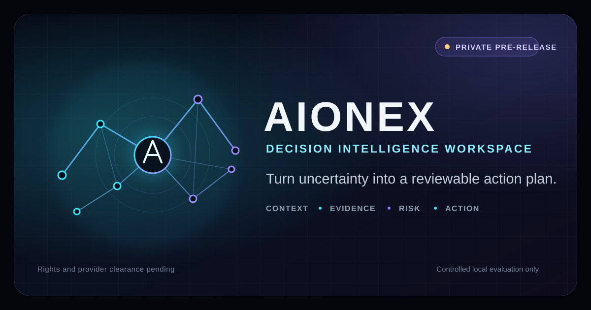
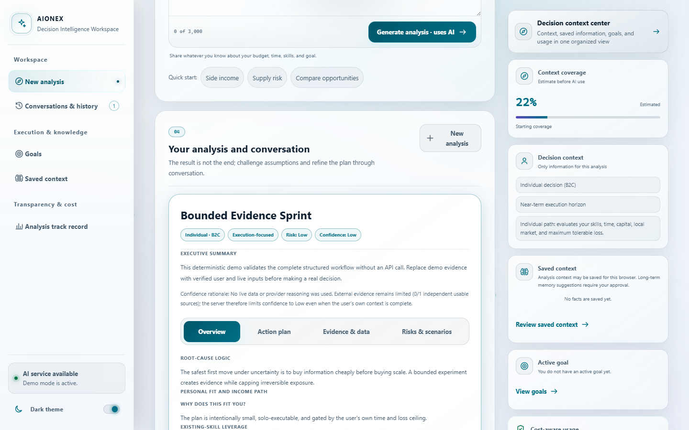
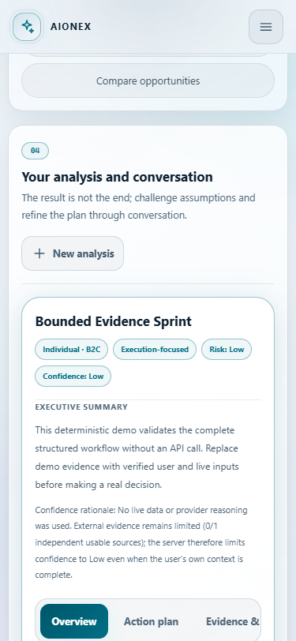

# AIONEX

AIONEX turns a bounded decision question into a structured, reviewable action plan. It combines deterministic intake, optional source-attributed public intelligence, schema-validated AI output or deterministic demo output, follow-up work, goals, and prediction tracking in one local-first workspace.

> **Status: private pre-release.** This repository is for controlled evaluation and engineering work only. Public or commercial distribution is not cleared. Rights, asset provenance, licensing, competition history, and external-provider obligations remain under review. See [Rights Clearance](RIGHTS_CLEARANCE.md), [License](LICENSE), and [Third-Party Notices](THIRD_PARTY_NOTICES.md) before copying, distributing, or enabling live providers.

There is no public service, production support commitment, security certification, outcome guarantee, or implied affiliation with any data or AI provider.

## What the current build does

| Capability | Current behavior | Important boundary |
| --- | --- | --- |
| Decision intake | Extracts known facts and asks bounded clarification questions without a model call | Intake quality depends on the information supplied and deterministic rules |
| Structured analysis | Produces validated B2C or B2B decision-support output through deterministic demo mode or a configured AI provider | Live model output can be wrong; provider use remains subject to clearance and account terms |
| Public intelligence | Routes to fixed public-source adapters and records source, observation time, cache state, freshness, authority, and limitations when available | Providers can be unavailable, stale, incomplete, jurisdiction-limited, or subject to changed terms |
| Action planning | Builds reviewable actions, scenarios, risk controls, evidence gaps, and review triggers | It does not execute transactions, contact third parties, or guarantee outcomes |
| Conversations | Supports bounded follow-up work linked to an analysis | Live follow-up requests can create additional provider usage |
| Saved context | Stores browser-scoped analysis history and recent context in local plaintext SQLite; long-term memory suggestions require confirmation | The signed anonymous cookie is not an account, and the database is not encrypted at rest |
| Goals | Creates goals from an analysis or manually, with manually updated progress and check-in dates | Progress is user-entered, not independently verified |
| Predictions | Stores falsifiable predictions and can resolve configured market signals | Resolution networking and the background sweeper are separately opt-in |
| Execution kit | Adds deterministic allowlisted resources and editable outreach templates | Resource availability, pricing, terms, and attribution still require operator review |
| Interface | Provides an English, responsive, keyboard-accessible workspace with light and dark themes | Accessibility has not been independently certified for a public deployment |

## Architecture

~~~mermaid
flowchart LR
    Browser["English browser workspace"]
    API["FastAPI policy and orchestration"]
    Intake["Deterministic intake"]
    Sources["Bounded public-source router"]
    Gateway["Demo or configured AI gateway"]
    Resources["Allowlisted execution resources"]
    Store["Local plaintext SQLite"]

    Browser <--> API
    API --> Intake
    API --> Sources
    API --> Gateway
    API --> Resources
    API <--> Store
~~~

The browser talks only to the same-origin FastAPI application. The server owns validation, outbound-network policy, provider invocation, record scoping, and persistence. Demo and offline policy can stop intelligence networking before an HTTP client is created. Prediction networking requires a separate opt-in.

| Area | Repository location |
| --- | --- |
| API routes, middleware, orchestration, health, and prediction policy | [app.py](app.py) |
| Deterministic clarification and fact extraction | [omni_intake.py](omni_intake.py) |
| AI gateway, schemas, budgets, and demo generation | [omni_ai.py](omni_ai.py) |
| Public-source routing, cache, freshness, and attribution metadata | [omni_intelligence.py](omni_intelligence.py) |
| Curated resources and execution templates | [omni_resources.py](omni_resources.py) |
| SQLite histories, memory, goals, predictions, and usage | [omni_store.py](omni_store.py) |
| English product interface | [templates/index.html](templates/index.html) and [static](static) |
| Automated checks | [tests](tests) |

For the detailed system model, read [Architecture](docs/ARCHITECTURE.md), [Technical Deep Dive](docs/TECHNICAL_DEEP_DIVE.md), [Security Model](docs/SECURITY_MODEL.md), [User Flows](docs/USER_FLOWS.md), and the [Decision Log](docs/DECISIONS/README.md).

## Safe local offline demo

The checked-in lock files and CI target CPython 3.14 on Windows x86-64. The following PowerShell setup keeps AI generation deterministic, disables public-intelligence networking, disables prediction networking, keeps API documentation off, and binds the application to loopback. Install dependencies before relying on the runtime network boundary; package installation itself may contact configured package indexes.

~~~powershell
python -m venv .venv
.\.venv\Scripts\Activate.ps1
python -m pip install --require-hashes -r requirements.lock

$env:OMNI_DEMO_MODE = "1"
$env:OMNI_AI_DEMO_MODE = "1"
$env:OMNI_OFFLINE_MODE = "1"
$env:OMNI_DEMO_ALLOW_NETWORK = "0"
$env:OMNI_PREDICTION_NETWORK_ENABLED = "0"
$env:OMNI_PREDICTION_SWEEPER_ENABLED = "0"
$env:OMNI_DISABLE_DOCS = "1"
$env:OMNI_HOST = "127.0.0.1"
$env:OMNI_PORT = "8000"
$env:OMNI_DB_PATH = Join-Path ([System.IO.Path]::GetTempPath()) ("aionex-" + [guid]::NewGuid().ToString("N") + ".sqlite3")
$env:OMNI_SESSION_SECRET = [Convert]::ToHexString(
    [System.Security.Cryptography.RandomNumberGenerator]::GetBytes(32)
)

python app.py
~~~

Open <code>http://127.0.0.1:8000</code> locally. Do not bind this pre-release to a public interface. The local HTTP example intentionally leaves secure cookies disabled; <code>OMNI_SECURE_COOKIE=1</code> is appropriate only behind a reviewed HTTPS deployment.

The application may create local database, write-ahead-log, cache, and session-secret files. Keep them outside version control and treat them as sensitive. The offline guarantee covers documented application paths under these settings; it does not control package managers, browser extensions, developer tools, proxies, or unrelated host software.

## Configuration

Use [.env.example](.env.example) as a reference, but prefer temporary process-level values for evaluation secrets. Use numeric <code>0</code> and <code>1</code> for documented boolean settings because parsing is not uniform across every switch.

| Variable | Safe evaluation value | Purpose and boundary |
| --- | --- | --- |
| <code>OMNI_DEMO_MODE</code> | <code>1</code> | Uses deterministic demonstration output instead of a paid AI request |
| <code>OMNI_AI_DEMO_MODE</code> | <code>1</code> | Direct AI-gateway demo switch; set it with <code>OMNI_DEMO_MODE</code> for an explicit evaluation configuration |
| <code>OMNI_OFFLINE_MODE</code> | <code>1</code> | Canonical offline switch; disables public-intelligence fetching and makes prediction networking unavailable |
| <code>OMNI_DEMO_ALLOW_NETWORK</code> | <code>0</code> or unset | Explicit opt-in for public-intelligence networking during demo mode; leave disabled pending provider review |
| <code>OMNI_PREDICTION_NETWORK_ENABLED</code> | <code>0</code> or unset | Explicit opt-in for prediction-resolution network calls; ineffective while offline mode is active |
| <code>OMNI_PREDICTION_SWEEPER_ENABLED</code> | <code>0</code> or unset | Enables background prediction resolution only when prediction networking is also enabled |
| <code>OMNI_OFFLINE</code> | unset | Compatibility fallback for application offline policy; use <code>OMNI_OFFLINE_MODE</code> as the canonical full offline control |
| <code>OPENAI_API_KEY</code> | unset | Required only for an authorized live AI evaluation; never place it in browser code or commit it |
| <code>OMNI_SESSION_SECRET</code> | random value of at least 32 characters | Signs the anonymous namespace cookie; this is not account authentication |
| <code>OMNI_DB_PATH</code> | isolated local path | Selects the plaintext SQLite file |
| <code>OMNI_DISABLE_DOCS</code> | <code>1</code> | Keeps interactive API documentation disabled |
| <code>OMNI_HOST</code> | <code>127.0.0.1</code> | Keeps the development server on loopback |
| <code>OMNI_PORT</code> | <code>8000</code> | Selects the local listening port |
| <code>OMNI_SECURE_COOKIE</code> | <code>0</code> for loopback HTTP | Set to <code>1</code> only behind reviewed HTTPS termination |
| <code>OMNI_HTTP_PROXY</code> | unset | Optional outbound proxy; configuring it changes the network trust boundary |
| <code>OMNI_ANALYSIS_MODEL</code>, <code>OMNI_CHAT_MODEL</code>, <code>OMNI_DEEP_DIVE_MODEL</code> | checked-in defaults | Provider model requests remain subject to hard application bounds and provider availability |
| <code>OMNI_MAX_ANALYSES_PER_DAY</code>, <code>OMNI_MAX_CHAT_MESSAGES_PER_DAY</code>, <code>OMNI_MAX_DEEP_DIVES_PER_DAY</code> | checked-in defaults or lower | Per-namespace usage limits; not a substitute for distributed public-service rate limiting |

Do not enable live AI, public intelligence, or prediction networking merely to make a demo appear complete. First review current terms, data handling, pricing, licensing, attribution, rate limits, jurisdiction, and the intended input data.

## Testing

Install the development requirements and run the local checks:

~~~powershell
python -m pip install --require-hashes -r requirements-dev.lock
python -m pytest -q
python -m ruff check .
~~~

The checked-in workflow is available at [.github/workflows/ci.yml](.github/workflows/ci.yml). A public CI badge is intentionally omitted because the repository remains private.

Default tests are intended to use demo/offline settings and must not require a live AI credential. Tests do not prove production security, legal clearance, provider compliance, accessibility certification, or decision accuracy.

## Data and privacy boundaries

- Questions, answers, analyses, messages, recent contexts, goals, predictions, and usage metadata can be written to plaintext SQLite.
- A signed anonymous browser cookie scopes local records. It is a bearer credential for a namespace, not a verified identity, login, role, recovery mechanism, or tenant boundary.
- Recent analysis context can be retained automatically for that browser namespace. Suggested long-term memory facts are stored only after explicit confirmation.
- Clearing application records does not erase copied databases, backups, filesystem snapshots, logs, or provider-side records.
- A live AI provider receives the bounded query and relevant structured context required for the requested operation. Provider-side handling is controlled by the applicable account settings and service terms.
- Public-source routing does not interpolate raw user text into upstream URLs, but enabled adapters still make requests to their fixed providers.
- Local secrets, databases, and generated artifacts must not be committed.

Read [SECURITY.md](SECURITY.md) for reporting guidance and [docs/SECURITY_MODEL.md](docs/SECURITY_MODEL.md) for the detailed threat model and deployment gate.

## Provider, attribution, and rights caveat

External providers are dependencies, not partners or endorsers. Their availability, terms, acceptable-use rules, pricing, attribution duties, rate limits, geographic coverage, and data accuracy can change independently of this repository. Preserve provider/source metadata and required attribution. Do not add provider marks to AIONEX branding.

The current evidence does not establish complete authorship, asset provenance, competition history, or distribution rights. The repository therefore carries a temporary no-license position and must remain private until the documented clearance gate is resolved:

- [Rights Clearance](RIGHTS_CLEARANCE.md)
- [Third-Party Notices](THIRD_PARTY_NOTICES.md)
- [Notices](NOTICE.md)
- [License](LICENSE)

## Screenshots

These screenshots were captured from the reviewed local build in demo and offline modes with a temporary database and synthetic decision context. They contain no live-provider data, credentials, or personal user data.

### Desktop decision workspace

### Mobile decision workspace

The SVG above is an original code-native identity graphic, not an application screenshot.

## Project governance

| Document | Purpose |
| --- | --- |
| [SECURITY.md](SECURITY.md) | Sensitive and non-sensitive vulnerability reporting paths |
| [CONTRIBUTING.md](CONTRIBUTING.md) | Authorized private contribution workflow and rights checks |
| [CODE_OF_CONDUCT.md](CODE_OF_CONDUCT.md) | Expected conduct in private project spaces |
| [SUPPORT.md](SUPPORT.md) | Evaluation support boundaries and safe diagnostics |
| [CHANGELOG.md](CHANGELOG.md) | Unreleased repository changes without implying a public release |
| [ROADMAP.md](ROADMAP.md) | Clearance and engineering gates without dates or delivery promises |

## Responsible use

AIONEX is decision-support software. It is not autonomous execution, professional financial advice, legal advice, compliance approval, medical advice, a safety system, or a promise of profit, accuracy, funding, procurement success, or any other result. Evidence and model output may be wrong, incomplete, stale, or unsuitable. Review sources, assumptions, dates, constraints, and consequences with qualified humans before acting.

Do not use this pre-release with regulated, confidential, client, credential, or high-impact personal data unless an authorized review has established an appropriate legal, security, and operational basis.
