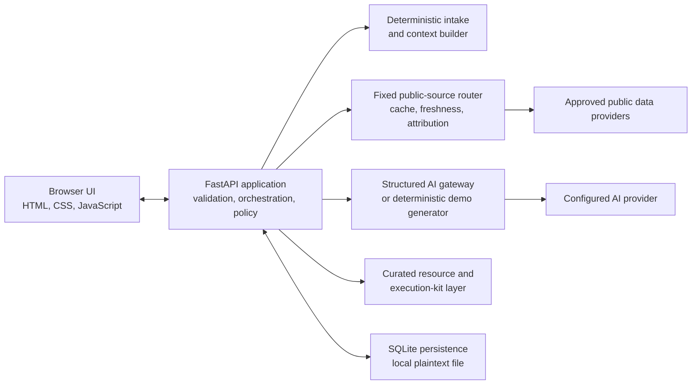

# AIONEX Architecture

> Status: Private pre-release engineering documentation. **AIONEX** is used only as the product presentation name in this repository; it does not imply a corporate affiliation, public service, or ownership claim beyond the underlying project rights.

## Purpose and scope

AIONEX is a local-first strategy workspace that turns a bounded intake into structured B2C or B2B decision support. It can add source-attributed public intelligence, generate a schema-validated analysis through an AI provider, retain an anonymous browser-session history, support follow-up work, and track goals and falsifiable predictions.

The present build is a single-process pre-release application. It is suitable for local evaluation and controlled development. It is not a hardened public multi-tenant service, an account system, or a guarantee of business, investment, legal, compliance, or operational results.

## System context

The browser communicates only with the same-origin FastAPI application. The server decides whether outbound provider calls are allowed. Demo and CI settings disable network-dependent intelligence by default, and prediction resolution has separate opt-in network switches.

## Runtime components

| Component | Current responsibility | Important boundary |
| --- | --- | --- |
| [`app.py`](../app.py) | FastAPI lifecycle, request models, middleware, route orchestration, confidence caps, usage limits, and prediction resolution | Central policy layer; not a distributed service |
| [`omni_intake.py`](../omni_intake.py) | Deterministic clarification questions, fact extraction, answer validation, and readable context | No model call is needed for intake |
| [`omni_ai.py`](../omni_ai.py) | Bounded AI configuration, structured output schemas, provider errors, timeouts, concurrency, demo outputs, and usage metadata | User and retrieved content is serialized as untrusted data |
| [`omni_intelligence.py`](../omni_intelligence.py) | Intent-to-source routing, fixed public adapters, response-size and time bounds, per-source caching, stale fallback, evidence quality, and offline envelopes | Raw user text is not interpolated into upstream URLs or query languages |
| [`omni_resources.py`](../omni_resources.py) | Deterministic allowlisted resources, templates, and execution kits | URLs are selected from a curated catalog rather than invented by a model |
| [`omni_store.py`](../omni_store.py) | SQLite schema, transactions, anonymous namespaces, histories, goals, predictions, usage, leases, and budget reservations | Data is stored in plaintext unless the operator adds storage encryption |
| [`templates/index.html`](../templates/index.html) and [`static/`](../static/) | English product interface, same-origin API client, responsive interaction, and accessible states | Browser content is not an authentication boundary |

## Primary request path

1. Security middleware assigns a request identifier, rejects oversized mutation bodies, validates or creates a signed anonymous session cookie, and applies response security headers.
2. Strict Pydantic request models reject unknown fields and enforce length and enum bounds.
3. Intake logic generates deterministic questions and validates the submitted answers.
4. The source router derives local routing tags and selects a bounded set of fixed providers. Offline or demo policy can return a deterministic degraded envelope before an HTTP client is created.
5. The AI gateway either returns deterministic demonstration data or makes one bounded structured-output request. It does not silently retry a paid provider request.
6. Confidence is capped according to independent usable evidence, not merely the number of stream records.
7. The local resource layer attaches allowlisted links and execution guidance.
8. SQLite transactions persist the result inside the anonymous browser-session namespace.

## Persistence model

SQLite is initialized at application startup and uses foreign keys, a busy timeout, write locking, and write-ahead logging. The current schema separates:

- anonymous clients and opt-in profile memory;
- intake sessions and completed analyses;
- follow-up messages and deep-dive cache entries;
- goals and progress state;
- falsifiable predictions and later calibration results;
- provider usage events, generation leases, and budget reservations.

This separation supports local consistency and testability, but it is not encrypted at rest. Anyone with filesystem access to the database can inspect its plaintext content. Backup, deletion, retention, encryption, and access-control policy remain operator responsibilities.

## Identity and isolation

The application uses a long-lived, HMAC-signed cookie containing an anonymous client identifier. Store queries scope user-visible records to that identifier. This prevents casual identifier tampering, but it is not account authentication:

- there are no usernames, passwords, verified email addresses, roles, or recovery controls;
- the cookie is a bearer credential for the local namespace;
- browser or cookie compromise can expose that namespace;
- clearing or losing the cookie can make prior data inaccessible unless an authorized migration path exists;
- this model is not sufficient for an internet-facing multi-user deployment.

See the [security model](SECURITY_MODEL.md) before adapting identity or hosting.

## Operational modes

| Mode | Relevant configuration | Network behavior |
| --- | --- | --- |
| Deterministic demo | `OMNI_DEMO_MODE=1` or `OMNI_AI_DEMO_MODE=1` | AI output is synthetic demonstration data. Public intelligence is network-free by default. |
| Canonical offline | `OMNI_OFFLINE_MODE=1` | Intelligence returns a deterministic degraded envelope with zero source fetches, and application prediction networking remains disabled. `OMNI_OFFLINE` is accepted only as a legacy application fallback. |
| Demo intelligence opt-in | `OMNI_DEMO_ALLOW_NETWORK=1` | Public intelligence may use configured fixed adapters while AI remains in demo mode. Use only after reviewing provider terms. |
| Controlled live evaluation | Demo flags disabled, an AI key configured, and outbound policy reviewed | Selected public providers and the configured AI provider may receive requests. |
| Prediction networking | `OMNI_PREDICTION_NETWORK_ENABLED=1`; background sweep also needs `OMNI_PREDICTION_SWEEPER_ENABLED=1` | Explicitly enables current-value lookups; it remains disabled when application offline mode is active. |

For a completely network-free evaluation, enable the demo flags and set `OMNI_OFFLINE_MODE=1`. Keep both prediction-network flags disabled.

## External-provider boundary

Public intelligence adapters use fixed HTTPS destinations and expose provider, source URL, observation date, cache state, freshness, authority, and limitations when available. Adapters can fail independently. A stale cached observation is labeled as stale and receives a confidence penalty; unavailable branches remain degraded rather than being presented as live.

Provider availability, acceptable-use terms, licensing, attribution rules, rate limits, geographic applicability, and data accuracy can change. The operator must review them before enabling live calls and must not remove required attribution. Public data and model output are evidence inputs, not guarantees.

In live AI mode, the configured provider receives the bounded query and relevant structured context needed for the requested operation. The gateway requests `store=False`, but provider-side handling is still governed by the applicable service agreement and account settings.

## Deployment assumptions and next boundaries

The current architecture assumes one trusted operator, one application process, same-origin browser access, and a local writable filesystem. Before any public or client deployment, the design needs an explicit decision on:

- account authentication, authorization, session rotation, recovery, and revocation;
- encryption at rest, secret management, backups, retention, and deletion evidence;
- durable distributed rate limiting and job coordination;
- reverse-proxy trust, TLS, host validation, observability, and incident response;
- provider contracts, data-processing terms, attribution, and jurisdiction;
- migration from local SQLite when concurrency or availability requirements exceed its role.

Related documents: [Technical Deep Dive](TECHNICAL_DEEP_DIVE.md), [User Flows](USER_FLOWS.md), [Security Model](SECURITY_MODEL.md), and [Decision Log](DECISIONS/README.md).
